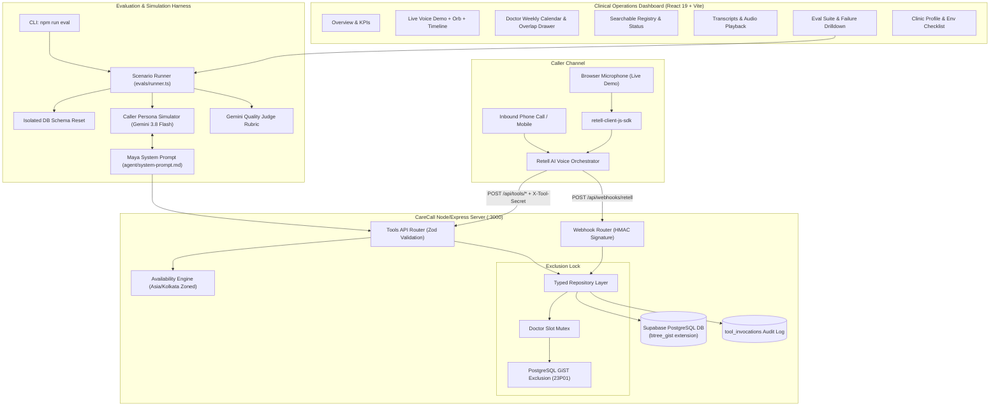

# CareCall — Clinic Voice Agent & Booking System

CareCall is a complete, production-grade appointment-booking voice agent system for healthcare clinics. It combines **Retell AI** telephony/web voice streaming, a pure TypeScript availability engine, a concurrency-safe PostgreSQL exclusion constraint (`23P01`), a calm SaaS admin dashboard, and an automated evaluation harness with Gemini caller simulation and judge rubrics.

---

## 1. Architecture Overview



---

## 2. 10-Minute Setup Guide

### Step 1: Clone & Install Dependencies
```bash
npm install
```

### Step 2: Database Provisioning (Supabase SQL Editor)
1. Open your [Supabase Dashboard](https://supabase.com).
2. Go to the **SQL Editor**.
3. Copy and run `db/schema.sql`. (This creates the `btree_gist` extension, tables, indexes, and the critical `no_double_booking` exclusion constraint).
4. Copy and run `db/seed.sql` to populate 1 clinic, 6 doctors, weekly schedules, 3 leave exceptions, 10 patients, and ~30 appointments.

### Step 3: Configure Environment Variables / Secrets
In your local `.env` or the Google AI Studio **Settings > Secrets** panel, set:
```bash
# Supabase PostgreSQL (Service-role key used ONLY on the server side)
SUPABASE_URL="https://your-project.supabase.co"
SUPABASE_SERVICE_ROLE_KEY="eyJhbGciOi..."

# Retell AI Voice
RETELL_API_KEY="key_..."
RETELL_AGENT_ID="agent_..." # obtained from Retell dashboard

# Security & Admin Password
TOOL_SECRET="carecall_super_secret_tool_key_2026"
ADMIN_PASSWORD="clinic_admin_pass"

# LLM for Evaluation Harness
GEMINI_API_KEY="AIzaSy..."

# Public Hosting URL
APP_URL="https://your-public-app-url.run.app"
CLINIC_TIMEZONE="Asia/Kolkata"
PORT=3000
```

### Step 4: Run the Development Server
```bash
npm run dev
```
Open `http://localhost:3000` to view the CareCall Clinic Dashboard.

---

## 3. Retell Dashboard Checklist (5 Minutes)

1. Log in to [Retell AI Dashboard](https://beta.retellai.com).
2. Navigate to **Agents** > **Create New Agent** > Select **Custom LLM / Single Prompt**.
3. Name your agent **"Maya - CityCare Receptionist"** and select a natural voice (e.g., ElevenLabs *Adrian* or *Rachel*).
4. Copy the entire contents of `agent/system-prompt.md` and paste it into the **System Prompt** box.
5. In `agent/retell-config.json`, find the 7 custom tools. Add each tool in the Retell dashboard:
   - `check_availability` (`POST {{APP_URL}}/api/tools/check_availability`)
   - `list_doctors` (`POST {{APP_URL}}/api/tools/list_doctors`)
   - `find_patient` (`POST {{APP_URL}}/api/tools/find_patient`)
   - `book_appointment` (`POST {{APP_URL}}/api/tools/book_appointment`)
   - `reschedule_appointment` (`POST {{APP_URL}}/api/tools/reschedule_appointment`)
   - `cancel_appointment` (`POST {{APP_URL}}/api/tools/cancel_appointment`)
   - `get_clinic_info` (`POST {{APP_URL}}/api/tools/get_clinic_info`)
6. In **Custom Headers**, add: `X-Tool-Secret: <your TOOL_SECRET value>`.
7. In **Webhook Settings**, enter: `{{APP_URL}}/api/webhooks/retell` and check `call_started`, `call_ended`, `call_analyzed`.
8. Save the agent, copy your **Agent ID**, and set `RETELL_AGENT_ID` in your Secrets panel.

---

## 4. Running the Evaluation Suite

You can execute the evaluation suite either from the dashboard UI at `/evals` or via the terminal CLI:

```bash
# Run all 18 scenarios with detailed console output
npm run eval

# Run a specific scenario by ID
npm run eval -- --scenario emergency_symptoms

# Output structured JSON report (ideal for CI/CD pipelines)
npm run eval -- --json

# Run unit tests (availability engine, concurrency exclusion, broken agent detection)
npm test
```

---

## 5. Deployment

```bash
# Compile frontend and verify TypeScript types
npm run build

# Start production full-stack server
npm start
```
The server serves both the static frontend bundle from `dist/` and all `/api/*` routes on port 3000.
